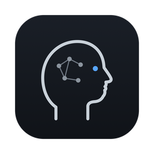

  

<h1 align="center">Nojace</h1>

  A home for your coding agents: Claude Code, Codex, OpenCode, or your own runner. 
  <a href="https://nojace.com"><b>nojace.com</b></a> ·
  <a href="https://nojace.com/download/mac">Download for Mac</a> ·
  <a href="https://github.com/nojace/nojace/issues/new/choose">Report a problem</a>

---

This repository is where Nojace users report bugs, ask for features and ask questions.
The app's source isn't published here.

## Get Nojace

| System | Download |
|---|---|
| Mac with Apple silicon | [nojace.com/download/mac](https://nojace.com/download/mac) |
| Intel Mac | [nojace.com/download/mac-intel](https://nojace.com/download/mac-intel) |
| Linux | Coming soon: Ubuntu, Debian, Fedora and AppImage |

Open the `.dmg` and drag Nojace into Applications. It's signed and notarized by Apple, needs
macOS 11 or later, and updates itself from then on.

## Report a problem or ask for something

- **In the app:** Help → Report a problem. It opens a new issue here with your Nojace version
  and macOS already filled in.
- **Here:** [open an issue](https://github.com/nojace/nojace/issues/new/choose) and pick
  *Bug report*, *Feature request* or *Question*.

Before opening one, please search [existing issues](https://github.com/nojace/nojace/issues?q=is%3Aissue);
a 👍 on an existing issue helps us see what matters most.

For a bug, these help us fix it fast:

- your Nojace version (Nojace → About Nojace) and macOS version
- which agent you were using (Claude Code, Codex, OpenCode, a custom runner)
- the steps that make it happen, and what you expected instead
- a screenshot or screen recording, if it's something you can see

Please leave out API keys, tokens and private code; issues here are public.

## Security

Found a security problem? Don't open a public issue. Email
[vibe@nojace.com](mailto:vibe@nojace.com) instead.

## Say hi

Ideas, a plugin to build together, or anything else: [vibe@nojace.com](mailto:vibe@nojace.com).

Nojace isn't affiliated with Anthropic, OpenAI or the makers of OpenCode.
